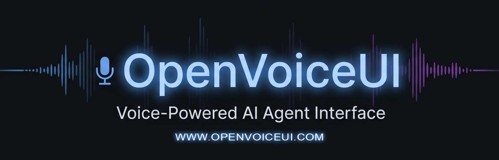

<p align="center">
  
</p>

<h1 align="center">OpenVoiceUI</h1>
<p align="center"><strong>A browser-based, voice-first "AI computer" for your own agent.</strong></p>

<p align="center">
  <a href="https://www.npmjs.com/package/openvoiceui"></a>
  <a href="https://github.com/MCERQUA/OpenVoiceUI/releases"></a>
  <a href="https://github.com/MCERQUA/OpenVoiceUI/actions/workflows/tests.yml"></a>
  <a href="LICENSE"></a>
  <a href="https://mcerqua.github.io/OpenVoiceUI/"></a>
</p>

<p align="center">
  <a href="#quick-start">Quick start</a> ·
  <a href="#features">Features</a> ·
  <a href="#how-it-works">How it works</a> ·
  <a href="#configuration">Configuration</a> ·
  <a href="https://mcerqua.github.io/OpenVoiceUI/">Docs</a> ·
  <a href="CONTRIBUTING.md">Contributing</a>
</p>

---

OpenVoiceUI is the front end of a self-hosted AI agent. You talk to it in the browser; the agent
answers out loud and can put real, interactive HTML pages on screen while it talks: dashboards,
tools, galleries, reports, full web apps. It also plays and generates music, drives an OS-style
desktop of saved pages, and exposes everything through a mobile-friendly admin dashboard.

The agent itself runs in [OpenClaw](https://openclaw.ai), an open-source agent gateway that
routes to the LLM provider you choose (OpenAI, Anthropic, Groq, Z.AI, Gemini and others) and
supplies tools, skills, memory and sub-agents. OpenVoiceUI is a Flask server plus a vanilla-JS
browser app that sits in front of that gateway and handles voice in, voice out, and everything
you see. Other agent backends can be added as gateway plugins.

Self-hosted and MIT licensed: your hardware, your keys, your data.

## Features

**Voice**
- Hands-free conversation with wake word, push-to-talk, interruption ("interject") and a text
  mode toggle.
- Speech-to-text: browser Web Speech (default, free), Deepgram streaming, Groq Whisper, or any
  Whisper-compatible server you run.
- Text-to-speech from nine providers, from free and local to premium cloned voices (see
  [Providers](#providers)), with per-profile voice settings and a fallback chain.
- Voice cloning through Qwen3-TTS (fal.ai), ElevenLabs or Resemble.

**Canvas and desktop**
- The agent builds and opens live HTML canvas pages mid-conversation; pages update in place.
- An OS-style desktop (Windows XP, macOS, Ubuntu, Windows 95 and Windows 3.1 themes) that holds
  every saved page, with a start menu, recent pages and a recycle bin.
- Shipped pages include a file explorer, image tools (AI image creator, splitter, grid creator,
  bulk uploader), icon library, camera capture and job albums, interactive map, sing-along,
  voice studio, terminal, ChatGPT conversation import and a canvas style picker.
- Each canvas page has public/private and lock controls in the admin dashboard; with
  authentication enabled, pages are private by default.

**Media**
- Suno music generation from voice, with a built-in player and playlists.
- Image generation through Hugging Face models and Google Gemini/Imagen.
- An audio clip creator (text to MP3) and sound-effect soundboard.

**Agent**
- Profiles: switch persona, voice, gateway and LLM settings per agent.
- Animated faces: the "AI Eyes" and halo-smoke orb faces, a custom-face editor, and face plugins.
- Sub-agent visibility, and the agent's workspace files (identity, instructions, memory) are
  browsable and editable from the dashboard.
- Credential vault with one-click OAuth connectors (Supabase, GitHub, Netlify).

**Operations**
- Admin dashboard (`/admin`): profiles, agent editor, plugins, canvas pages, custom faces,
  workspace files, music, provider and voice configuration, connectors, health and sessions,
  updates, logs and a built-in connector test suite.
- Optional Clerk authentication for public deployments.
- One-click self-update, and plugins installed from a remote catalog.

> **Screenshots:** none are checked into the repository yet. The
> [documentation site](https://mcerqua.github.io/OpenVoiceUI/) and
> [openvoiceui.com](https://openvoiceui.com) show the UI.

## Quick start

All install paths need [Docker](https://docs.docker.com/get-docker/) installed and running,
except the native Linux server install.

### npm CLI (recommended)

Requires Node.js 18+ and Docker.

```bash
npx openvoiceui setup     # interactive wizard: LLM + TTS providers, API keys, builds the images
npx openvoiceui start     # starts OpenClaw, Supertonic TTS and OpenVoiceUI
```

Open **http://localhost:5001**. Other commands: `stop`, `restart`, `status`, `logs`.

The wizard writes `.env` and an `openclaw-data/` folder (the gateway's config, workspace and a
pre-paired device identity), then runs Docker Compose with `docker-compose.local.yml` layered on
top so the gateway can read that config and your keys.

### Pinokio

In [Pinokio](https://pinokio.co), add OpenVoiceUI from this repository's URL
(`https://github.com/MCERQUA/OpenVoiceUI`), then click **Install** and **Start**. Pinokio does
not install Docker for you: its installer checks that Docker is installed and running, asks for
your API keys, and then runs the same setup as the npm wizard (`setup-config.js` + Docker
Compose).

### Docker Compose (manual)

```bash
git clone https://github.com/MCERQUA/OpenVoiceUI.git
cd OpenVoiceUI
cp .env.example .env      # edit: gateway token, TTS keys, SECRET_KEY
docker compose up --build
```

This starts three containers:

| Service | Port | Purpose |
|---|---|---|
| `openclaw` | 18791 | Agent gateway (routes to your LLM provider) |
| `supertonic` | internal | Free local text-to-speech |
| `openvoiceui` | 5001 | Voice UI, canvas, API and admin dashboard |

`openvoiceui` shares the `openclaw` container's network, so port 5001 is published through the
`openclaw` service. With plain `docker compose`, the gateway does **not** receive `.env` or a
generated config: either configure OpenClaw's LLM provider yourself (see
[OpenClaw requirements](docs/getting-started/openclaw-requirements.md)), or use the npm wizard,
which does it for you.

### Linux server (systemd + nginx + SSL)

```bash
git clone https://github.com/MCERQUA/OpenVoiceUI.git
cd OpenVoiceUI
cp .env.example .env                    # edit with your keys
python3 -m venv venv && venv/bin/pip install -r requirements.txt
# edit DOMAIN and EMAIL at the top of setup-sudo.sh, then:
sudo bash setup-sudo.sh
```

`setup-sudo.sh` offers to install OpenClaw at the tested version (or use an existing install),
then writes the nginx reverse-proxy config, gets a Let's Encrypt certificate, and installs the
`openvoiceui` systemd service that runs `venv/bin/python3 server.py`. See [docs/SETUP.md](docs/SETUP.md) for the full walkthrough.

## Requirements

| | Version |
|---|---|
| Python | 3.11+ (CI runs 3.11; the Docker image uses 3.12) |
| Node.js | 18+ (npm CLI and Pinokio helpers only) |
| Docker + Compose | Any current release (npm, Pinokio and Docker installs) |
| OpenClaw | The tested version pinned in `docker-compose.yml`, `deploy/openclaw/Dockerfile` and `setup-sudo.sh` (kept in sync by `bump-openclaw-version.sh`) |
| Browser | A current Chrome or Edge is recommended for the default Web Speech STT; other browsers can use Deepgram or Groq Whisper. Microphone access is required for voice. |

## Configuration

Configuration lives in `.env`. Copy [`.env.example`](.env.example), which documents the available
options.

| Setting | Needed for |
|---|---|
| `CLAWDBOT_GATEWAY_URL`, `CLAWDBOT_AUTH_TOKEN` | Connecting to the OpenClaw gateway. Docker Compose sets the URL for you. |
| `SECRET_KEY` | Stable sessions across restarts (a random key is generated if unset). |
| A TTS provider key, e.g. `GROQ_API_KEY` | Cloud voices. Supertonic works with no key. |
| `DEEPGRAM_API_KEY` | Deepgram streaming speech-to-text (optional). |
| `SUNO_API_KEY` | Music generation (optional). |
| `CLERK_PUBLISHABLE_KEY`, `CANVAS_REQUIRE_AUTH` | Login for public deployments (optional). |

LLM provider keys belong to the gateway: OpenClaw's own setup (or the npm wizard) configures
which model the agent uses. Server behaviour is tuned in [`config/`](config/) (YAML), agent
personas in [`profiles/`](profiles/), and the voice system prompt in
[`prompts/voice-system-prompt.md`](prompts/voice-system-prompt.md), which is hot-reloaded.

## How it works

```
 Browser  (index.html + src/ ES modules, no build step)
   │  mic ──► speech-to-text (Web Speech / Deepgram / Groq Whisper / your server)
   │  POST /api/conversation ──► streamed reply (NDJSON) ──► text-to-speech ──► speaker
   │  canvas iframe ◄── server-sent events when pages change
   ▼
 OpenVoiceUI server  (Flask, server.py, port 5001)
   ├─ routes/            conversation, canvas, music, admin, vault, uploads, ...
   ├─ services/          gateway manager, auth, TTS, plugins, paths, ...
   │    └─ gateways/openclaw.py ──WebSocket──►  OpenClaw gateway (port 18791) ──► your LLM
   ├─ tts_providers/     Supertonic, Groq, Resemble, ElevenLabs, Hume, ...
   └─ runtime/           canvas pages, uploads, music, transcripts (persistent volumes)
```

The agent controls the interface with short tags in its replies (for example, open a canvas
page, play a track, change the face's mood). The browser strips the tags from what is spoken and
acts on them. The tag set is documented in [Agent Tags](docs/reference/agent-tags.md). The full
technical map is [docs/ARCHITECTURE.md](docs/ARCHITECTURE.md).

### Repository layout

| Path | Contents |
|---|---|
| `server.py`, `app.py` | Flask entry point and app factory |
| `routes/` | Flask blueprints, one per feature area |
| `services/` | Backend services: gateway manager and gateways, auth, TTS, plugins, vault, paths |
| `providers/`, `tts_providers/` | Provider registry and TTS/STT/LLM provider implementations |
| `src/` | Browser app (vanilla JS ES modules): adapters, core, shell bridges, UI, faces |
| `static/`, `index.html`, `sounds/` | Static assets, page shell, soundboard clips |
| `default-pages/`, `default-faces/`, `default-styles/` | Canvas pages, face template and style presets shipped with the app |
| `canvas-shared/` | Shared scripts for canvas pages |
| `skills/`, `install-skills.js` | Agent skills bundled for OpenClaw and their installer ([docs/SKILLS.md](docs/SKILLS.md)) |
| `plugins/` | Plugin catalog stubs and the example gateway |
| `profiles/`, `prompts/`, `config/` | Agent profiles, the voice system prompt, server configuration |
| `deploy/` | Container builds for OpenClaw, Supertonic and optional services |
| `cli/`, `pinokio.js`, `install.js`, `start.js`, ... | npm CLI and Pinokio launcher scripts |
| `setup-sudo.sh`, `setup-nginx.sh`, `openvoiceui.service` | Native Linux server install |
| `tests/` | pytest suite |
| `docs/`, `website/` | Documentation and the Docusaurus site that publishes it |
| `archive/` | Superseded files kept for reference (not shipped) |

[docs/REPO-ORGANIZATION.md](docs/REPO-ORGANIZATION.md) explains the layout and the planned
clean-ups.

## Providers

**LLM.** Through the OpenClaw gateway: any provider OpenClaw supports (OpenAI, Anthropic, Groq,
Z.AI GLM, Google Gemini, MiniMax and more). A direct Z.AI fallback path exists for slow or empty
gateway turns. Other agent backends plug in as gateway plugins (see
[`plugins/example-gateway`](plugins/example-gateway/)).

**Text-to-speech** ([`tts_providers/providers_config.json`](tts_providers/providers_config.json))

| Provider | Notes | Key |
|---|---|---|
| Supertonic | Local, free; ships with the Docker setup | none |
| Pocket TTS | Local voice cloning | none |
| Groq Orpheus | Fast cloud TTS | `GROQ_API_KEY` |
| Qwen3-TTS (fal.ai) | Cloud voice cloning | `FAL_KEY` |
| Qwen3-TTS (local) | Voice cloning on your own GPU | none |
| Resemble AI | Premium cloned voices | `RESEMBLE_API_KEY` |
| ElevenLabs | Large voice library, instant cloning | `ELEVENLABS_API_KEY` |
| Hume Octave | Emotion and acting-direction TTS | `HUME_API_KEY` |
| xAI Grok | Cloud TTS | `XAI_API_KEY` |

**Speech-to-text:** browser Web Speech (default), Deepgram streaming (`DEEPGRAM_API_KEY`), Groq
Whisper, xAI, or an external Whisper-compatible server (`STT_API_URL`).

**Realtime voice adapters** ([`src/adapters/`](src/adapters/)): ElevenLabs, Hume EVI and xAI
Grok Realtime, opt-in per profile. New adapters start from
[`src/adapters/_template.js`](src/adapters/_template.js).

## Plugins

Plugins add face packs, canvas pages, gateways or combinations of them, and are installed from the
admin dashboard. This repository carries the catalog entries (`plugin.json` + `README.md`); the
plugin code lives in the [plugins repository](https://github.com/MCERQUA/openvoiceui-plugins).

| Plugin | Type | What it adds |
|---|---|---|
| BHB Animated Characters | Face pack | Animated BigHead Billionaires characters with lip-sync and moods, by [BHaleyart](https://github.com/BHALEYART) |
| Hermes Agent | Gateway | The [Hermes](https://github.com/NousResearch/hermes-agent) self-improving agent as a standalone or OpenClaw+Hermes hybrid backend (pinned version in its `plugin.json`) |
| Booking | Canvas pages | Appointment booking pages backed by a Cal.diy instance |
| MidiViz | Canvas page | Audio-reactive MIDI visualizer |
| SEO Platform | Canvas page | SEO dashboard powered by DataForSEO |
| Twenty CRM | Canvas page | Embedded Twenty CRM with a setup wizard |
| Example Gateway | Gateway template | Echo gateway to copy when building your own |

Build your own with the [plugin guide](plugins/README.md) and the
[plugin system docs](docs/extending/plugin-system.md).

## Bundled agent skills

OpenVoiceUI ships OpenClaw skills in [`skills/`](skills/) that teach the agent its own features: canvas pages and their visibility, canvas design, custom faces, Suno music, Three.js pages, and voice conversation rules. Every installer puts them where OpenClaw loads them (`~/.openclaw/skills/openvoiceui/`): Docker, Pinokio and npm mount them read-only, native installs copy them. See [docs/SKILLS.md](docs/SKILLS.md) for what each one does, how updates work, and where your own skills go.

## Development

```bash
python3 -m venv venv
venv/bin/pip install -r requirements.txt pytest
cp .env.example .env
venv/bin/python3 server.py                 # http://localhost:5001
venv/bin/python3 -m pytest tests/ -q       # test suite (CI runs this on every PR)
```

There is no frontend build step: edit files under `src/` and reload. See
[CONTRIBUTING.md](CONTRIBUTING.md) for the branch workflow (trunk-based, PRs to `main`), code
style and how to add providers, adapters and gateway plugins. AI coding agents should start with
[AGENTS.md](AGENTS.md).

## Documentation

- **Docs site:** [mcerqua.github.io/OpenVoiceUI](https://mcerqua.github.io/OpenVoiceUI/), built
  from [`docs/`](docs/): [installation](docs/getting-started/installation.md),
  [configuration](docs/getting-started/configuration.md),
  [OpenClaw requirements](docs/getting-started/openclaw-requirements.md),
  [features](docs/features/), [customization](docs/customization/),
  [extending](docs/extending/), [API reference](docs/reference/api.md).
- **Repository docs:** [Architecture](docs/ARCHITECTURE.md) · [Vision](docs/VISION.md) ·
  [Setup guide](docs/SETUP.md) · [Bundled agent skills](docs/SKILLS.md) ·
  [Releasing](docs/RELEASING.md) ·
  [Repository organization](docs/REPO-ORGANIZATION.md) · [Design plans](docs/plans/)
- **Project:** [Changelog](CHANGELOG.md) · [Contributing](CONTRIBUTING.md) ·
  [Code of Conduct](CODE_OF_CONDUCT.md) · [Security policy](SECURITY.md) ·
  [Contributors](CONTRIBUTORS.md)

## Contributing

Contributions are welcome: providers, canvas pages, faces, plugins, docs and fixes. Read
[CONTRIBUTING.md](CONTRIBUTING.md), open a pull request against `main`, and keep each PR to one
change. Community plugins go to the
[plugins repository](https://github.com/MCERQUA/openvoiceui-plugins). Please report security
issues privately as described in [SECURITY.md](SECURITY.md).

## License

[MIT](LICENSE) © OpenVoiceUI contributors.

<p align="center">
  <a href="https://openvoiceui.com">Website</a> ·
  <a href="https://mcerqua.github.io/OpenVoiceUI/">Docs</a> ·
  <a href="https://www.npmjs.com/package/openvoiceui">npm</a> ·
  <a href="https://github.com/MCERQUA/openvoiceui-plugins">Plugins</a>
</p>
